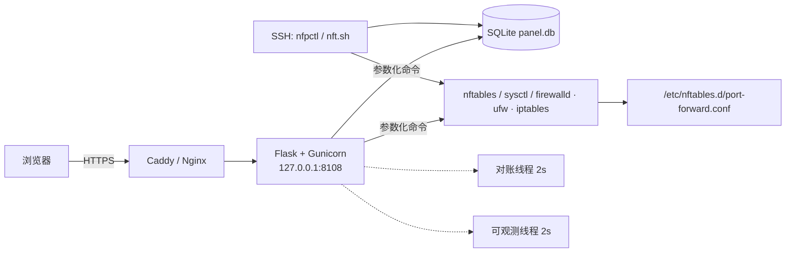

# nftables 端口转发面板（Mochi Forward）

[](https://github.com/CinnieMochi/nft-forward-panel/actions/workflows/release.yml)

给一台 Linux VPS 加一个 Web 控制台，管理 nftables 的 **TCP + UDP 端口转发**：多用户、配额、限速、审计、实时流量监控，全部由一份 SQLite 数据库驱动。它在内部复刻了经典 `nft.sh` 的转发逻辑（DNAT + SNAT），但不再靠手工编辑 nftables 配置文件。

- 数据源唯一：数据库是真相，`/etc/nftables.d/port-forward.conf` 只是它渲染出来的运行产物。
- 改动可回滚：写入前先 `nft -c -f` 校验，失败自动还原配置文件和上一份备份，线上规则不受影响。
- 只用参数数组调用系统命令，全程不拼接 shell；所有规则改动都走事务锁 + 原子写入。
- 绝不 `flush ruleset`，也绝不创建或清空你的 `/etc/nftables.conf`。

---

## 一键安装（推荐）

**前置条件**：Debian 11/12 或 Ubuntu 22.04/24.04，root 权限，一个已解析到该 VPS 的域名，云安全组放行 **TCP 80 / 443**（面板本身只监听 `127.0.0.1:8108`，不需要也不应该对外开放）。

```bash
# 1. 下载安装器
curl -fsSL https://raw.githubusercontent.com/CinnieMochi/nft-forward-panel/v1.2.1/install.sh -o /tmp/nfp-install.sh

# 2. 先审阅，再执行（不要 curl | bash）
less /tmp/nfp-install.sh

# 3. 安装：交互式询问域名、证书邮箱、管理员账号和密码
sudo bash /tmp/nfp-install.sh
```

仓库名和版本已有默认值（`--version` 默认装 **latest**，即最新 Release），所以不必再传 `--repo`。

安装完成后终端会打印访问地址，浏览器打开 `https://<你的域名>` 即可登录。证书由 Caddy 自动申请和续期。

### 全自动（无交互）安装

适合脚本化或重复部署。密码只通过环境变量传入，不会进 shell 历史：

```bash
curl -fsSL https://raw.githubusercontent.com/CinnieMochi/nft-forward-panel/v1.2.1/install.sh -o /tmp/nfp-install.sh
sudo NFP_ADMIN_PASSWORD='至少12位的强密码' bash /tmp/nfp-install.sh \
  --non-interactive \
  --domain panel.example.com \
  --email you@example.com \
  --admin admin
```

### 安装器做了什么

1. `apt-get` 安装 `nftables`、`conntrack`、`python3-venv`、`sqlite3`、`caddy` 等依赖（Caddy 缺失时自动添加官方 apt 源）。
2. 解压 Release 压缩包到 `/opt/nft-forward-panel`，用 `pip check` 校验 Python 依赖，建立独立 venv。
3. **校验发布包 SHA-256**：从 GitHub Release API 读 asset 的 `digest`，与本地 `sha256sum` 比对，不一致直接中止。
4. 建 `/var/lib/nft-forward-panel`（0700）与 `/etc/nft-forward-panel.env`（0600），自动生成 `PANEL_SECRET_KEY`。
5. 给 `/etc/nftables.conf` 补 `include "/etc/nftables.d/*.conf"`，并用 `nft -c -f` 校验；失败会还原原文件后退出。
6. 安装 systemd 服务并启动，然后**轮询 `/healthz` 最多 30 秒**确认面板真的应答了才继续。
7. 写入 Caddy 站点配置（`/etc/caddy/conf.d/nft-forward-panel.caddy`），`caddy validate` 失败会还原原 `Caddyfile`。
8. 首次安装成功后，自动把 `PANEL_ADMIN_PASSWORD` 从环境文件里删掉——它此后再也不会被读取。

### 更新

重复执行安装器并填入**同一个域名**即可。升级会保留 `/var/lib/nft-forward-panel` 里的数据库和头像，并在覆盖前备份旧程序目录、环境文件、`/etc/nftables.conf` 和 `Caddyfile`。

```bash
curl -fsSL https://raw.githubusercontent.com/CinnieMochi/nft-forward-panel/v1.2.1/install.sh -o /tmp/nfp-install.sh
less /tmp/nfp-install.sh
sudo bash /tmp/nfp-install.sh --version v1.2.1
```

> 固定 `--version` 到明确的 Release 标签，不要跟着可变的 `main` 分支走。

---

## 手动安装（自己负责 Nginx / 证书）

不想让安装器接管 Caddy 时：

```bash
sudo apt update && sudo apt install -y nftables conntrack python3 python3-venv
sudo install -d -m 0755 /opt/nft-forward-panel
sudo cp -a . /opt/nft-forward-panel/
cd /opt/nft-forward-panel
sudo python3 -m venv .venv
sudo .venv/bin/pip install -r requirements.txt

sudo openssl rand -hex 32          # 生成 PANEL_SECRET_KEY
sudo install -m 0600 /dev/null /etc/nft-forward-panel.env
sudoedit /etc/nft-forward-panel.env   # 参考 .env.example 填写

sudo install -m 0755 nft.sh nfpctl.py /opt/nft-forward-panel/
sudo ln -sf /opt/nft-forward-panel/nft.sh /usr/local/sbin/nfpctl
sudo cp deploy/nft-forward-panel.service /etc/systemd/system/
sudo systemctl daemon-reload
sudo systemctl enable --now nft-forward-panel
```

Nginx 反代最小示例（证书另配）：

```nginx
server {
    listen 443 ssl http2;
    server_name panel.example.com;
    # ssl_certificate / ssl_certificate_key ...
    location / {
        proxy_pass http://127.0.0.1:8108;
        proxy_set_header Host $host;
        proxy_set_header X-Real-IP $remote_addr;
        proxy_set_header X-Forwarded-Proto $scheme;
    }
}
```

记得保持 `PANEL_TRUSTED_PROXY_COUNT=1`（单层反代）。

---

## 环境变量

系统会读 `/etc/nft-forward-panel.env`（systemd `EnvironmentFile`），完整样例见 [`.env.example`](.env.example)。

| 变量 | 默认值 | 说明 |
| --- | --- | --- |
| `PANEL_SECRET_KEY` | 无（必填） | 会话签名密钥，缺失时拒绝启动。`openssl rand -hex 32` |
| `PANEL_ADMIN_USERNAME` | `admin` | 仅在数据库无任何用户时用于创建首个管理员 |
| `PANEL_ADMIN_PASSWORD` | 无 | 同上；首次成功后应从环境文件删除 |
| `PANEL_DATA_DIR` | `/var/lib/nft-forward-panel` | 数据库与头像目录 |
| `PANEL_FORWARD_CONFIG` | `/etc/nftables.d/port-forward.conf` | 面板渲染的规则文件（运行产物） |
| `PANEL_MAIN_CONFIG` | `/etc/nftables.conf` | 主配置，仅用于补 include 行，不会被创建或清空 |
| `PANEL_SYSCTL_CONFIG` | `/etc/sysctl.d/99-nft-forward.conf` | 写入 `net.ipv4.ip_forward=1` |
| `PANEL_COOKIE_SECURE` | `1` | 是否给 Cookie 加 `Secure`；纯 HTTP 调试时设 `0` |
| `PANEL_TRUSTED_PROXY_COUNT` | `0` | 信任的反代层数，`0` 表示完全忽略 `X-Forwarded-*` |
| `PANEL_POLICY_SCHEDULER` | `1` | 是否启用 2 秒一次的对账线程，`0` 会让配额/到期/端口范围失效 |
| `PANEL_LOGIN_WINDOW_SECONDS` | `600` | 登录限流窗口 |
| `PANEL_LOGIN_MAX_ATTEMPTS` | `20` | 窗口内允许的失败次数 |
| `PANEL_TIMEZONE` | `Asia/Shanghai` | 月流量周期与日期显示所用时区（IANA 名称） |
| `PANEL_UPDATE_REPO` | `CinnieMochi/nft-forward-panel` | 在线更新时拉取 Release 的仓库，改动后只接受该仓库发布且摘要匹配的包 |

---

## 账号与权限

- **管理员**：查看/新增/修改/删除**所有**规则；把规则指派给任意启用用户；管理用户策略；查看审计日志。
- **普通用户**：只能看到和操作自己的规则；限速继承账号默认值，不能自选端口范围外的端口。

每个账号有：规则上限、允许端口区间、月流量额度（GiB）、本周期已用流量（可被管理员校准）、到期时间、月流量重置日/时间、入口地址、默认双向限速。

规则被暂停的四种原因，优先级从高到低：

1. `disabled` — 账号被停用
2. `expired` — 超过到期时间
3. `quota` — 月流量超额
4. `port_range` — 监听端口落在该账号允许范围之外

暂停**不会删除**规则：nftables 里摘掉、数据库里标记，条件恢复后自动重新加载。

---

## 流量口径与限速

- 每条规则同时转发 TCP 和 UDP，只支持 IPv4。
- 计费口径是**网卡方向的 RX + TX 合计**：`wire_prerouting`(-90) / `wire_postrouting`(+300) 两条 filter 链分别统计物理入向和出向字节。NAT 链只看每个连接的首包，所以逻辑方向另外记在 `forwarding`(+20) 钩子跳转的 `nfp_in_*` / `nfp_out_*` 链里。
- 每 5 分钟聚合进 `traffic_buckets`，保留 60 天。
- 限速用 `limit rate over N kbytes/second drop`，N = Mbps × 125，进出方向各自独立。
- 老版本写入的历史桶只有 `inbound/outbound` 没有 `rx/tx`，计费时会按行回退到逻辑口径，升级不会清空当期已用流量。

---

## 版本信息与在线更新

左下角的「控制台运行中」右侧显示**当前版本号**，点一下可以：

- 看到**当前版本**和 GitHub 上的**最新版本**（只有一个发布渠道，不区分稳定/开发版）
- 点「检查最新版」实时查询（服务端向 GitHub Releases API 查询，结果缓存 15 分钟）
- **管理员**在有新版本时可以直接点「立即更新」

在线更新的实现和边界：

1. 只从 `PANEL_UPDATE_REPO`（默认本仓库）的 **Release** 取包，不接受任意 URL。
2. 下载后必须与 GitHub 报告的 asset **SHA-256 摘要**一致，否则中止。
3. 由 `deploy/self-update.sh` 以独立 systemd 临时单元（`systemd-run`）执行——面板重启不会杀掉更新进程。
4. 更新前把当前 `/opt/nft-forward-panel` 整目录备份为 `.backup-<时间戳>`（只保留最近两份），然后覆盖程序文件、补齐 venv 依赖、重启。
5. **健康检查不通过会自动回滚**旧版本并重启，状态写入 `/var/lib/nft-forward-panel/update.status`，前端实时显示进度。
6. 数据库不在覆盖范围内，升级不会改动你的账号、规则与流量记录。

> 只有管理员能触发；每次触发都会写审计（`panel_update`）。如果服务器出不了网，用安装器或 SSH 手动升级。

## 界面小工具

- **隐藏端口与目标地址**：概览页「入口地址」右侧的 ◉ 按钮，一键把规则表的**监听端口**和**目标地址**替换成占位符，再点恢复；状态记在浏览器本地，刷新后保持。
- **用户管理**：管理员在「用户与策略」可以对账户执行**编辑**（用户名 / 邮箱，身份 ID 不可改）和**删除**。删除会一并清掉该账户的历史流量记录；若它仍拥有转发规则，会要求先删除或转移规则；审计日志保留（只解绑操作者）。不能删除自己，也不会删掉最后一个启用的管理员。

## SSH 备用管理（nfpctl）

WebUI 或反代挂掉时，用同一套后端继续管理。需要 root，读 `/etc/nft-forward-panel.env` 的路径配置，与 WebUI **共用数据库、审计、校验、渲染、文件锁和回滚**。

```bash
sudo nfpctl list
sudo nfpctl status
sudo nfpctl add --port 2443 --target 8.8.8.8 --target-port 443 --owner admin
sudo nfpctl remove 1 --yes
sudo nfpctl clear --yes
sudo nfpctl menu        # 交互式菜单
```

`nft.sh` 只是 `nfpctl.py` 的包装器（`/usr/local/sbin/nfpctl` 软链到它）。

> 不要再让别的脚本并行编辑 `port-forward.conf` 或接管 `ip port_forward` 表，否则面板下次保存时会覆盖那些外部改动。

---

## 架构



两个后台守护线程：

| 线程 | 周期 | 职责 |
| --- | --- | --- |
| 策略对账 | 2 s | 结算流量 → 重算每条规则的暂停原因 → 仅在有变化时重建 nft 表 → 同步防火墙 → 写审计 |
| 实时可观测 | 2 s | conntrack 连接快照 + 线程池 TCP 延迟探测，结果进内存缓存 |

HTTP 请求只读缓存，不做任何 conntrack 调用或 socket 探测——这是面板能 2 秒刷一次还不卡住的原因。

---

## 开发与测试

要求 Python **3.10+**（CI 用 3.12）。测试不依赖 root、nftables 或 Linux：`nft`、`conntrack`、防火墙命令在用例里都被 mock 掉了。

```bash
python3 -m venv .venv
. .venv/bin/activate
pip install -r requirements.txt

PYTHONPATH=. python3 -m unittest discover -s tests -v
```

本地起开发服务器：

```bash
export PANEL_SECRET_KEY="$(openssl rand -hex 32)"
export PANEL_ADMIN_USERNAME=admin
export PANEL_ADMIN_PASSWORD='change-this-to-a-strong-password'
export PANEL_DATA_DIR="$(pwd)/.data"
export PANEL_POLICY_SCHEDULER=0      # 开发时关掉对账线程
flask --app app run --debug
```

在非 Linux 或非 root 环境下登录、权限、校验、配额逻辑都能跑；真正加载 nftables 规则时会明确提示权限或缺少系统命令，这是预期行为。

健康检查端点：`GET /healthz` → `{"status":"ok"}`，无需登录，不碰数据库。

---

## 发布流程

```bash
git tag -a v1.2.1 -m "v1.2.1"
git push origin v1.2.1
```

推送 `v*` 标签会触发 [`.github/workflows/release.yml`](.github/workflows/release.yml)：跑完整测试 → `bash -n` 检查安装器 → 打包并生成 SHA-256 → **校验包内布局**（必需文件齐全、不含 `.git`/`.github`）→ 创建 GitHub Release 并附上两个资产。

**任何一步失败都不会发布 Release**，这样安装器下载到的包至少是通过测试的。详细步骤见 [`GITHUB_DEPLOY.md`](GITHUB_DEPLOY.md)。

---

## 故障排查

```bash
systemctl status nft-forward-panel caddy nftables
journalctl -u nft-forward-panel -n 100 --no-pager
curl -fsS http://127.0.0.1:8108/healthz
nft list table ip port_forward
sudo nfpctl status
```

| 现象 | 排查方向 |
| --- | --- |
| 安装器报 `panel did not answer /healthz` | 看 `journalctl`；多半是 `PANEL_SECRET_KEY` 缺失或 venv 依赖没装好 |
| 面板起来但规则不生效 | `nft list table ip port_forward` 是否为空；`sysctl -n net.ipv4.ip_forward` 是否为 1 |
| 加了规则但连不上 | 云安全组是否放行该监听端口；本机防火墙是否真的放行（看审计里的警告） |
| 账号到期/超额后规则还在转发 | `PANEL_POLICY_SCHEDULER` 是否被设成 0 |
| 登录一直被限流 | 清 `login_attempts` 表，或调大 `PANEL_LOGIN_WINDOW_SECONDS`/`PANEL_LOGIN_MAX_ATTEMPTS` |
| 忘记管理员密码 | `sudo nfpctl` 不处理密码；用 sqlite 改 `users.password_hash` 或重建账号 |

---

## 安全说明与限制

- 面板以 root 运行（nftables、sysctl、防火墙都需要 root），因此**必须**放在 HTTPS 之后；systemd unit 已启用 `ProtectSystem=full`、`ProtectHome`、`PrivateTmp` 和 `ReadWritePaths` 白名单。
- 会话 Cookie：`HttpOnly` + `SameSite=Lax` + 可选 `Secure`；全站 CSRF；登录限流；改密或停用账号会让旧会话立即失效（`session_version`）。
- 响应头带 CSP（`default-src 'self'`）、`X-Frame-Options: DENY`、`nosniff`、`Referrer-Policy`，HTTPS 时加 HSTS。
- 只支持 **IPv4**，每条规则固定同时转发 TCP 和 UDP。
- 面板不会安装 nftables、不会 `flush ruleset`、不会新建 `/etc/nftables.conf`——它只接管自己那个 `ip port_forward` 表。
- 多副本不适合横向扩展：设计方案就是「单机 + 单库 + 文件锁」。

---

## 版本

### v1.2.1

- 新增：左下角显示当前版本号，点开可查看**最新版本**并由管理员**一键在线更新**（摘要校验 + 自动回滚 + 审计）。
- 新增：概览页可一键**隐藏/显示监听端口与目标地址**，适合录屏或截图时脱敏。
- 新增：用户管理支持**编辑账户资料**（用户名 / 邮箱）与**删除账户**，含自我保护与最后管理员保护。
- 修复：README 里的 mermaid 架构图在 GitHub 上无法渲染（未加引号的标签与 `&` 连线语法）。
- 依赖：新增 `deploy/self-update.sh`，安装器与发布包都会带上它。

### v1.2.0

- 修复：升级后当前计费周期的已用流量被清零（老桶只有 `inbound/outbound`，新口径只算 `rx/tx`）。现在按行回退，升级不清零额度。
- 新增：`GET /healthz` 健康检查端点，安装器用它判断面板是否真的就绪。
- 新增：`PANEL_TIMEZONE` 环境变量（默认 `Asia/Shanghai`），缺 tz 数据库时不再导致启动崩溃。
- 修复：测试套件长期红灯——3 个用例与实现脱节，且 CI 注入的 `PANEL_ADMIN_PASSWORD` 会覆盖测试夹具的管理员口令，导致 13 个用例连锁失败。现在夹具自己钉住身份，环境不再能改变它。
- 依赖：补 `tzdata`，Windows/macOS 上也能跑测试。
- 安装器：仓库名和版本有了默认值（不再强制 `--repo`）；就绪检测从「sleep 2 + curl /」改为轮询 `/healthz` 最多 30 秒。
- 流水线：Actions 锁定 commit SHA，打包后校验 SHA-256 与包内布局，校验失败不出 Release。

### v1.1.0

- 网卡方向（RX/TX）计费、实时带宽、连接数与延迟监控、按规则双向限速。
